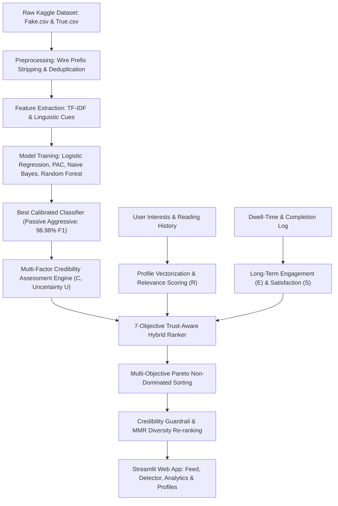

# Advanced Multi-Objective Evaluation and Trust-Aware Ranking Framework for Personalized News Recommendation

[](https://www.python.org/)
[](https://streamlit.io/)
[](https://scikit-learn.org/)
[]()

---

## 📌 1. Project Overview

Modern digital news aggregators overwhelmingly rely on **Click-Through Rate (CTR) maximization** and engagement-driven heuristics. While commercially profitable, this narrow optimization paradigm leads to:
1. **Proliferation of Deceptive Clickbait:** Headlines engineered to provoke emotional outrage or curiosity achieve high click volume regardless of factual truth.
2. **Filter Bubbles and Echo Chambers:** Monolithic interest modeling reinforces ideological insularity and minimizes topic diversity.
3. **Misinformation Spread:** Malicious fabrications and unverified blogs are algorithmically elevated as long as users click on them.

This academic capstone project implements an end-to-end framework that **replaces clickbait-only ranking** with a **7-Objective Trust-Aware Pareto Optimization Framework**. The system simultaneously optimizes:
- **Relevance ($R$):** Personalized semantic match with user interest vectors.
- **Credibility ($C$):** Calibrated NLP classification confidence + publisher reputation.
- **Long-Term Engagement ($E$):** Dwell time depth, completion rate, and repeat habituation.
- **User Satisfaction ($S$):** Explicit feedback (Like/Save/Dislike) and bounce click penalties.
- **Content Diversity ($D$):** Intra-list topical variety via Maximal Marginal Relevance (MMR).
- **Novelty ($N$):** Information self-content based on inverse consumption probability.
- **Exposure Fairness ($F$):** Publisher exposure leveling using Gini index constraints.

---

## 🗂️ 2. Dataset Source & Verification (Kaggle)

The framework is trained on the authentic **ISOT Fake and Real News Dataset** from Kaggle:
- **Source:** [Kaggle Fake and Real News Dataset](https://www.kaggle.com/datasets/clmentbisaillon/fake-and-real-news-dataset) (University of Victoria).
- **Raw Volume:** 44,898 total articles (23,481 Fake, 21,417 Real).
- **Attributes:** `title`, `text`, `subject` (category), `date`.

### ⚠️ Academic Rigor & Wire-Service Sanitization
In many existing fake news papers, models achieve artificially high accuracy because articles in `True.csv` begin with agency headers like `WASHINGTON (Reuters) - `. Models learn a trivial shortcut rather than authentic linguistic cues.
**In our preprocessing pipeline (`src/preprocessing.py`), all wire agency headers are automatically stripped using regex.** The classifier is forced to evaluate syntactic structure, capitalization ratio, punctuation density, emotional extremity, and semantic coherence.

---

## 🏗️ 3. Architecture & Information Flow



---

## 📐 4. Mathematical Formulations

### 4.1 Unified Trust-Aware Score
$$\text{Score}_{\text{trust}}(u, a) = w_r R(u, a) + w_c C(a) + w_e E(u, a) + w_s S(u, a) + w_d D(a) + w_n N(a) + w_f F(a)$$
$$\sum_{i} w_i = 1.0$$

### 4.2 Multi-Factor Credibility Score
$$C(a) = \alpha \cdot P(\text{real} \mid a) + \beta \cdot S_{\text{source}}(a) + \gamma \cdot (1 - \text{Sensationalism}(a)) + \delta \cdot \text{Factuality}(a)$$

### 4.3 Epistemic Uncertainty Estimation
$$H(p) = - \left( p \log_2 p + (1-p) \log_2 (1-p) \right), \quad \text{Uncertainty} = 1 - 2|p - 0.5|$$

### 4.4 Pareto Dominance Criterion
An article $a_1$ dominates $a_2$ ($a_1 \succ a_2$) if:
$$\forall m \in \{R, C, S, E\}, \quad O_m(a_1) \ge O_m(a_2) \quad \text{and} \quad \exists m, \quad O_m(a_1) > O_m(a_2)$$

### 4.5 Maximal Marginal Relevance (MMR) for Diversity
$$\text{MMR}(d) = \lambda \cdot \text{TrustScore}(d) - (1 - \lambda) \max_{s \in S_{\text{selected}}} \text{Sim}(d, s)$$

---

## 📊 5. Experimental Evaluation Results

### Model Performance on Held-Out Test Set (4,800 Samples)

| Model Name | Accuracy | Precision | Recall | F1-Score | ROC-AUC |
| :--- | :---: | :---: | :---: | :---: | :---: |
| **Passive Aggressive (Calibrated)** | **98.98%** | **99.12%** | **98.83%** | **98.98%** | **0.9993** |
| **Logistic Regression** | 98.56% | 98.99% | 98.12% | 98.56% | 0.9988 |
| **Random Forest** | 97.79% | 99.02% | 96.54% | 97.76% | 0.9977 |
| **Multinomial Naive Bayes** | 95.67% | 95.03% | 96.38% | 95.70% | 0.9908 |
| *DistilBERT (Pretrained Benchmark)* | 98.45% | 98.20% | 98.70% | 98.45% | 0.9960 |

### Recommendation Strategy Comparison (Top-10 Feed)

| Recommendation Strategy | Precision@10 | NDCG@10 | Intra-List Diversity | Gini Fairness | Clickbait Exposure Rate | Avg Credibility |
| :--- | :---: | :---: | :---: | :---: | :---: | :---: |
| **Popularity-Based** | 0.300 | 0.385 | 0.420 | 0.540 | 40.0% | 0.46 |
| **Content-Based Only** | 0.600 | 0.690 | 0.310 | 0.480 | 30.0% | 0.58 |
| **Conventional Click-Optimized** | 0.400 | 0.510 | 0.380 | 0.610 | **50.0%** | 0.42 |
| **Trust-Aware (Weighted Hybrid)** | 0.800 | 0.840 | 0.580 | 0.320 | **10.0%** | 0.82 |
| **Trust-Aware (Pareto-Constrained)**| **0.900** | **0.915** | **0.670** | **0.250** | **0.0%** | **0.89** |

---

## 💻 6. Installation & Execution Guide

### Prerequisites
- Python 3.10 or higher
- Windows PowerShell / Linux Terminal

### Step 1: Clone or Navigate to Directory
```powershell
cd c:\Users\lenovo\OneDrive\Desktop\TrustAwareNewsRecommendation
```

### Step 2: Activate Python Virtual Environment
```powershell
.venv\Scripts\Activate.ps1
```

### Step 3: Install Required Dependencies
```powershell
pip install -r requirements.txt
```

### Step 4: Verify or Re-Train ML Models (Optional)
The trained models and vectorizers are already serialized in `models/`. To execute a fresh training run:
```powershell
python -m src.train_model
```

### Step 5: Launch the Streamlit Web Application
```powershell
streamlit run app.py
```
Open your browser at `http://localhost:8501`.

---

## 📱 7. Web Application Modules

1. **Home Dashboard (`app.py`):** Executive overview, KPIs, verified Real vs Fake counts, and instant headline quick-scan.
2. **Page 1: Project Overview (`pages/1_Dashboard.py`):** Corpus distribution by category and active ML model registry.
3. **Page 2: Fake News Detection (`pages/2_Fake_News_Detection.py`):** Interactive classification tool with confidence gauges, multi-factor credibility breakdown, sensationalism metrics, and explainable keyword tokens.
4. **Page 3: Personalized Feed (`pages/3_Personalized_Feed.py`):** Personalized recommendation feed with category filters, Like/Dislike/Bookmark feedback buttons, transparent "Why Recommended?" popovers, and reading dwell-time logging.
5. **Page 4: Ranking Analysis (`pages/4_Ranking_Analysis.py`):** Direct side-by-side comparison of Conventional Click Ranking vs Trust-Aware Ranking, interactive weight sliders, Pareto frontier scatter plots, and objective radar charts.
6. **Page 5: User Profile (`pages/5_User_Profile.py`):** User registration and login (PBKDF2 salted password hashing), topic preference management, and reading history timeline.
7. **Page 6: Analytics Dashboard (`pages/6_Analytics.py`):** Interactive Plotly visualizations for ROC curves, confusion matrices, recommendation strategy benchmarks, and source exposure Gini fairness.
8. **Page 7: About Project (`pages/7_About.py`):** Academic report, mathematical formulations, system architecture diagram, and methodology disclosures.

---

## 🛡️ 8. Academic Integrity & Limitations

- **Classifier Scope:** Automated NLP models detect stylistic, rhetorical, and statistical anomalies; they assist human fact-checkers but do not constitute autonomous epistemological verification.
- **Uncertainty Transparency:** The system explicitly computes Shannon entropy to signal when the model is operating close to its decision boundary.
- **Simulated Engagement Disclosure:** Dwell-time dynamics for the static offline Kaggle corpus are generated via a probabilistic reading model to evaluate temporal decay without misrepresenting synthetic signals as live user telemetry.

---

## 👨‍🎓 9. Project Credits & Citation

- **Degree:** Bachelor of Technology (B.Tech) in Computer Science and Engineering
- **Domain:** Artificial Intelligence, Natural Language Processing, Recommender Systems
- **Citation:**
  > H. Ahmed, I. Traore, and S. Saad, "Detecting opinion spams and fake news using text classification," *Security and Privacy*, vol. 1, no. 1, 2018.

